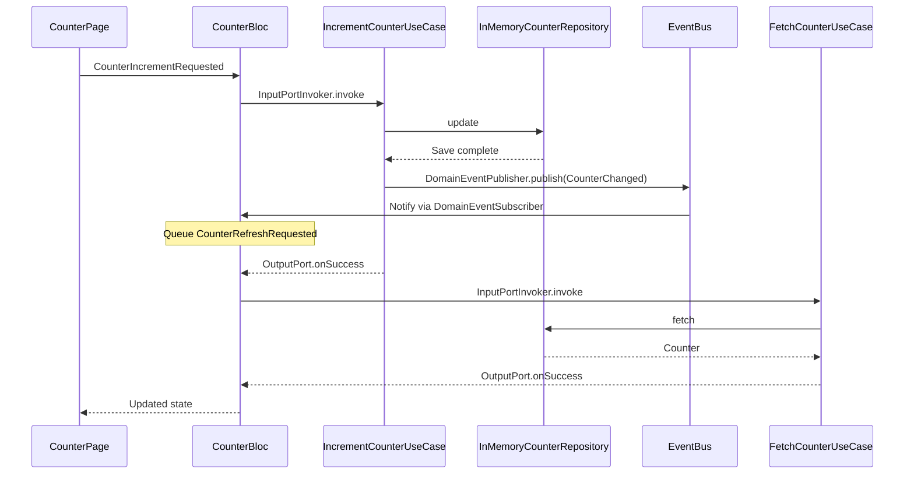
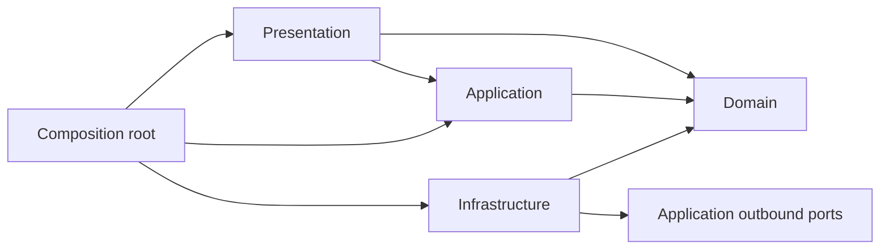

# Flutter Architecture

[日本語](https://github.com/mofua-suki/flutter-architecture/blob/main/README.ja.md)

This runnable Flutter counter shows how a screen action reaches a BLoC, a use case and a repository. Open a second screen with **Open another screen**, then tap **+1**. Each screen has its own BLoC. Both receive the change event and fetch the saved value.

## Run the sample

The project pins Flutter 3.47.7 in `.tool-versions`. The app requires Dart `>=3.13.0 <4.0.0`. Web scaffolding is included.

```sh
flutter pub get
flutter run -d chrome
```

The in-memory counter starts at zero each time the app restarts.

## Follow an update



Start with the [dependency wiring](lib/di/app_dependencies.dart), [CounterBloc](lib/presentation/bloc/counter/counter_bloc.dart) and [increment command](lib/application/counter/command/increment_counter_use_case.dart).

| Directory | Responsibility |
| --- | --- |
| `lib/presentation/bloc/share/bloc/` | Sequential event handling, initialization, state and mapping domain events to BLoC events |
| `lib/application/` | Input and output ports, queries, void and value commands, and their results |
| `lib/application/outbound_port/` | Contract for publishing domain events |
| `lib/domain/shared/` | Base contracts for domain objects, identifiers, events and repositories |
| `lib/domain/counter/` | Counter and its read and write repository contracts |
| `lib/infrastructure/` | In-memory repository, event bus and publishing adapters |
| `lib/presentation/event/` | Domain event subscription contract and adapter |
| `lib/di/` | Composition root and shared instances |

A use case validates its input before execution and reports the result through `OutputPort.onSuccess` or `OutputPort.onError`. The BLoC gets that result through `InputPortInvoker`. Queries read from the read repository. Commands use the write repository and publish domain events after saving.

Each subscriber uses a `TypedDomainEventBinding` to put a feature-specific event in the same sequential queue as screen actions. BLoCs share a synchronous event bus and unsubscribe on `close()`. Delivery has no persistence or replay. If a listener fails during matching or notification, the bus logs the event type, listener type, error and stack trace, then continues with the remaining listeners. DI provides a `ConsoleLogger` by default. Diagnostic failures preserve the save result and subsequent deliveries.

Listeners enqueue work for the BLoC event handler. A save can finish before all screens refresh. Tap **再読み込み** (reload) to refresh a screen that missed an update. Errors passed through a use case, output port and `Result` retain their original stack trace when rethrown by `unwrapOrThrow`.

## Sample scope

Use cases receive a logger, and commands also receive a domain event publisher. The counter operations extend the `Repository`, `ReadRepository` and `WriteRepository` contracts. The sample runs without `build_runner`. Retail workflows, API calls, authentication, databases, durable events and transactions are outside its scope.

## Generate a BLoC or use case

The generators use the local Mason library and can run without a global Mason CLI installation.

```sh
dart run tool/mason/generate_bloc.dart ProductList product/list
dart run tool/mason/generate_use_case.dart FetchProductList query product
dart run tool/mason/generate_use_case.dart SaveProduct command product
```

BLoCs go under `lib/presentation/bloc/<directory>/`. Use cases go under `lib/application/<directory>/query/` or `command/`. Matching tests go under `test/`. Use PascalCase names and slash-separated directory segments beginning with a lowercase letter and containing lowercase letters, digits or underscores. The generators skip existing files.

A generated BLoC initializes with empty state data. Generated use cases throw `UnimplementedError`. Replace a query's `Never` with the result type, inject the repository, implement the operation and update the generated test expectations. For event wiring, see `CounterBloc.domainEventBindings` in the constructor and the increment command.

## Linter

The root `analysis_options.yaml` enables Flutter lints and the local analyzer plugin under `tool/lint`. Its 12 rules cover issues such as reverse layer dependencies, write repositories in queries, forced null unwraps and missing entries in `props`. Rules for APIs outside the sample, including parallel futures and TransactionRunner, apply when that code is present. The redundant-type rule skips closure parameters whose inferred type it cannot establish.

Resolve the lint package separately to isolate its analyzer 13.0.0 dependency from the app's test analyzer. The root configuration references the local plugin through `plugins`, following the [Dart analyzer plugin configuration](https://dart.dev/tools/analyzer-plugins).

## Verify

Run these commands from the app root.

```sh
flutter pub get --enforce-lockfile
(cd tool/lint && dart pub get --enforce-lockfile)
dart format --output=none --set-exit-if-changed lib test tool/lint/lib tool/lint/test tool/mason/*.dart tool/mason/generator
flutter analyze
flutter test
flutter build web
```

Check the lint package separately from the app root.

```sh
cd tool/lint
dart pub get --enforce-lockfile
dart analyze
dart test
```

App tests cover screen actions, delivery to multiple BLoCs, sequential updates, unsubscribe, save failures, input validation and output notification.

## Dependency direction



Each layer can use shared types in `common`. BLoCs depend on input ports and the domain event subscriber. The counter uses Ready, Loading, Complete and Error states after initialization, retaining displayed data for recovery by reloading.

Screens share the repository and event bus. Each owns its BLoC. The first uses `BlocViewBuilder` for creation, initial load, subscription and disposal. The second uses the standard `BlocProvider` for the same lifecycle.

## Continuous verification

GitHub Actions analyzes and tests the app, the custom lint plugin and the Mason output. From the root of a checkout created with `git clone`, run `dart run tool/mason/verify_templates.dart` to generate and verify a BLoC, query and command in a temporary copy.
